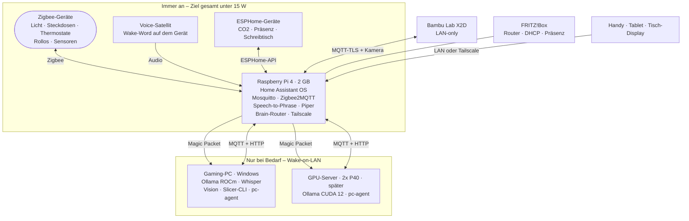
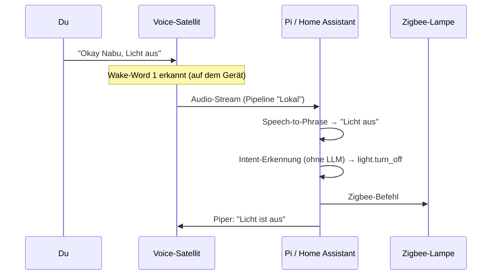
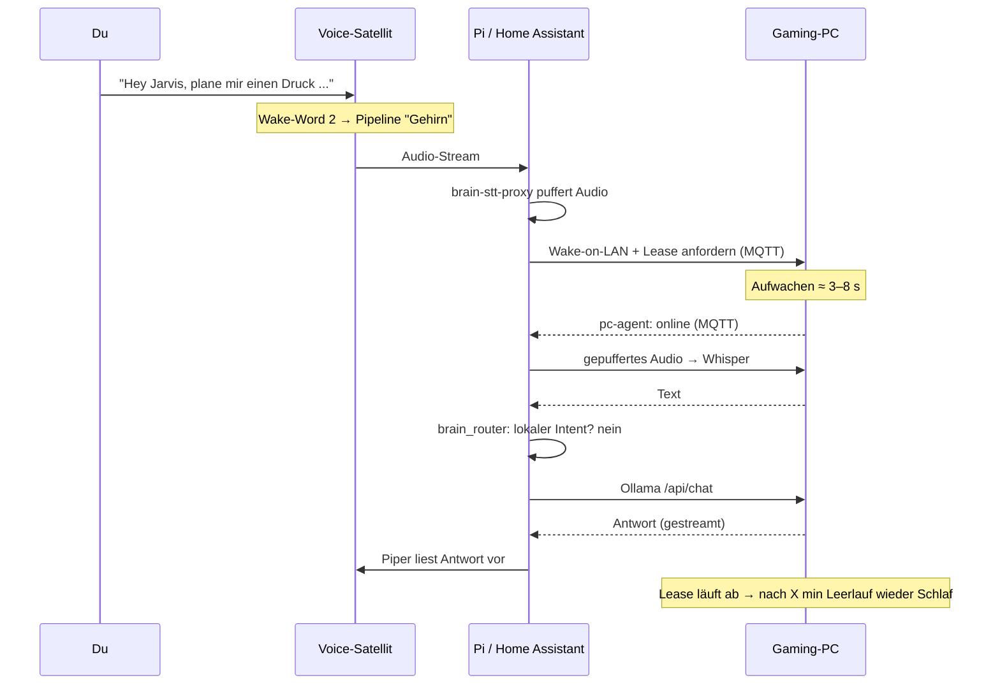

# 01 – Architektur

## Überblick

**Die Idee in einem Satz:** Home Assistant auf dem Pi ist die einzige Zentrale.
Alles – Geräte, Sprache, Drucker, Dashboard, KI-Chat – läuft dort zusammen. PC und
GPU-Server sind „Rechenknechte“ ohne eigene Logik für das Zuhause: Sie werden
geweckt, rechnen, melden sich ab und schlafen wieder.

## Was läuft wo – und warum

| Gerät | Software | Warum genau hier |
|---|---|---|
| **Raspberry Pi 4 (2 GB)** | Home Assistant OS mit Add-ons: Mosquitto (MQTT), Zigbee2MQTT, Speech-to-Phrase (Sprache → Text, nur bekannte Sätze), Piper (Text → Sprache), Tailscale (VPN), brain-stt-proxy (eigene Entwicklung, M4), ab M6 Spoolman. Eigene HA-Integration `brain_router` (M3). | Läuft 24/7 mit ≈ 4–5 W. Alles, was jederzeit sofort reagieren muss, gehört hierher. |
| **Voice-Satellit** (Vorschlag: Home Assistant Voice PE) | Wake-Word-Erkennung direkt auf dem Gerät (microWakeWord), Mikrofon, Lautsprecher | Mit 2 GB RAM ist der Pi knapp; Wake-Word auf dem Satelliten kostet den Pi 0 MB. Zwei Wake-Words → zwei Pipelines (lokal / Gehirn). Alternative mit openWakeWord auf dem Pi: siehe [Offene Fragen](00-offene-fragen.md). |
| **ESP32 mit ESPHome** | Firmware für Selbstbau-Sensoren: CO₂, mmWave-Präsenz, Schreibtisch-Steuerung, LED-Zonen | Billig (≈ 5 € pro Chip), lokal, Gehäuse druckst du selbst. |
| **Gaming-PC (Windows, LAN-Kabel)** | Ollama (ROCm), Whisper als Wyoming-Server, Slicer-CLI (Bambu Studio/OrcaSlicer), Bildverarbeitung, **pc-agent** (eigene Entwicklung, M3) | Einzige starke GPU bis zum Server. Schläft standardmäßig (S3, ≈ 1–3 W). |
| **GPU-Server 2× P40** (optional, M12) | Linux, Ollama/llama.cpp mit CUDA 12, Whisper, pc-agent | 48 GB VRAM für große Modelle, ohne den Gaming-PC zu blockieren. Siehe [10-gpu-server.md](10-gpu-server.md). |
| **FRITZ!Box** | Router, DHCP-Reservierungen, Anwesenheit (Handy im WLAN), optional WireGuard, optional Backup-Ziel (USB-Speicher) | Schon vorhanden. |
| **Bambu X2D** | Firmware im LAN-only-Modus + Developer Mode | Lokale Steuerung ohne Bambu-Cloud. |

### RAM-Budget Pi (2 GB) – Schätzung, wird in M1/M4 gemessen

| Komponente | RAM (ca.) |
|---|---|
| HA OS + Supervisor + HA Core | 600–800 MB |
| Mosquitto | 10 MB |
| Zigbee2MQTT | 120–180 MB |
| Speech-to-Phrase | 150–250 MB |
| Piper (eine deutsche Stimme) | 100–150 MB |
| Tailscale | 30–50 MB |
| brain-stt-proxy | 30–40 MB |
| Spoolman (ab M6) | 80–120 MB |
| **Summe** | **≈ 1,1–1,6 GB** |

Machbar, aber ohne große Reserve. Deshalb: Wake-Word **nicht** auf dem Pi, kein
Whisper auf dem Pi, Recorder schlank konfigurieren. Eine Automation in
`homeassistant/packages/pi_health.yaml` warnt, wenn der RAM dauerhaft über 85 %
liegt. Dann wäre ein Pi 4 mit 8 GB (≈ 80 €, gleicher Verbrauch) der Ausweg – kein
Pi 5 (braucht ≈ 1–2 W mehr).

## Stromverbrauch pro Komponente

Alle Werte sind **Schätzungen**. In M2 bekommen PC, Drucker, Pi und Schreibtisch
Messsteckdosen; danach ersetze ich die Zahlen hier durch Messwerte.

### Dauerverbrauch (24/7)

| Komponente | Leistung | Bemerkung |
|---|---|---|
| Pi 4 + USB-SSD + Zigbee-Stick | 4–5 W | Ziel < 6 W ✔ |
| Voice-Satellit | 1,5–2,5 W | pro Stück |
| Zigbee-Messsteckdosen | 0,3–0,6 W | pro Stück (Eigenverbrauch!) |
| ESP32-Sensoren am Netzteil | 0,5–1 W | pro Stück |
| Tisch-Display (Tablet, Bildschirm aus) | 0,3–1 W | per Präsenz an/aus |
| Batteriesensoren (Temperatur, Fenster) | ≈ 0 | |
| **Summe Smart-Home-Schicht** | **≈ 10–14 W** | ≈ 7–10 kWh/Monat |

### Bei Bedarf

| Komponente | Leistung | Wie oft |
|---|---|---|
| Gaming-PC im Schlaf (S3) | 1–3 W | Normalzustand |
| Gaming-PC wach, Leerlauf | 70–120 W | soll selten sein → Auto-Schlaf |
| Gaming-PC LLM-Last | 350–500 W | Sekunden bis Minuten pro Anfrage |
| GPU-Server Leerlauf / Last | 60–100 W / 500–600 W | nur wenn geweckt |
| Bambu X2D druckend | 150–400 W | messen; Standby nach Druck ausschalten |
| Aktive Lautsprecher Standby | 2–5 W | oft unterschätzt → per Steckdose aus |

**Warum sich das Wecken lohnt:** Ein PC, der 10 h am Tag nur „bereitsteht“, kostet
bei 90 W ≈ 0,9 kWh/Tag ≈ 27 kWh/Monat ≈ 9 €/Monat (bei 0,33 €/kWh). Der Pi
kostet im selben Monat ≈ 3,5 kWh ≈ 1,20 €.

## Datenflüsse

### 1. „Licht aus“ (einfacher Sprachbefehl) – PC bleibt aus

Dauer: ≈ 1 s. Kein LLM, kein PC.

### 2. „Plane mir einen Druck für ein Kabelhalter-Set“ – Gehirn wird geweckt

Erste Antwort nach ≈ 10–25 s (Aufwachen + Modell laden). Folgefragen, solange der
PC wach ist: wenige Sekunden.

### 3. PC geht schlafen

Windows schläft über seine **eigenen** Energieoptionen (z. B. nach 20 min ohne
Eingabe). Das Problem: Netzwerkanfragen (Ollama aus dem LAN) zählen für Windows
nicht als Aktivität, und nach einem Wake-on-LAN schläft Windows ohne
Tastatureingabe schon nach ≈ 2 min wieder ein („unbeaufsichtigtes Aufwachen“).
Deshalb hält der **pc-agent** den PC per Windows-API wach, solange eine Lease aktiv
ist oder Ollama ein Modell geladen hat – und gibt danach einfach wieder frei.
Windows erledigt den Rest. Details: [05-routing.md](05-routing.md).

### 4. Druck fertig

X2D meldet „fertig“ (MQTT) → HA: Push aufs Handy + Ansage → Abluft läuft 10 min
nach → Drucker kühlt ab (Düse/Bett < 50 °C) → nach 30 min ohne neuen Auftrag
Drucker-Steckdose aus.

## Netzwerk und Ports (nur LAN)

| Dienst | Gerät | Port | Wer darf zugreifen |
|---|---|---|---|
| Home Assistant | Pi | 8123/TCP | LAN + Tailscale |
| Mosquitto (MQTT) | Pi | 1883/TCP | LAN, nur mit Benutzer/Passwort |
| Ollama | PC/Server | 11434/TCP | **nur IP des Pi** (Windows-Firewall) – Ollama hat keine Anmeldung! |
| Whisper (Wyoming) | PC/Server | 10300/TCP | nur IP des Pi |
| pc-agent | PC/Server | – | baut nur ausgehend MQTT auf, kein offener Port |
| X2D | Drucker | 8883 (MQTT-TLS), 990 (FTPS), Kamera | Pi; Ports beim Einrichten prüfen (neues Modell) |
| Ins Internet | – | **keiner** | – |

## Grundsatzentscheidungen

| Entscheidung | Warum | Verworfen |
|---|---|---|
| **Home Assistant OS** auf dem Pi | Add-ons, Backups, Updates mit einem Klick; offiziell ab 2 GB RAM unterstützt | Raspberry Pi OS + Docker: mehr Kontrolle, aber mehr Pflege |
| **Zigbee** als Funkstandard | Geräte brauchen kaum Strom, Mesh, keine Cloud, riesige Auswahl, Zigbee2MQTT sehr ausgereift | WLAN-Geräte: je ≈ 1 W Eigenverbrauch, oft Cloud-Zwang. Thread/Matter: kommt, aber Auswahl/Werkzeuge noch dünner – Koordinator, der später auch Thread kann, ist eine Option |
| **MQTT** als Nervensystem | Zigbee2MQTT, pc-agent, Drucker sprechen es; lose Kopplung, jedes Teil austauschbar | Direkte HTTP-Kopplung: fragiler bei schlafenden Geräten |
| **Zwei Wake-Words** statt „KI rät, ob es schwer ist“ | Du entscheidest beim Sprechen, ob der PC geweckt wird. Kein unnötiges Aufwecken durch Fehlerkennung. | Ein Wake-Word + automatische Erkennung: Speech-to-Phrase kann freie Sätze nicht erkennen → bräuchte Whisper → bräuchte immer den PC |
| **Gehirn ohne Hausverantwortung** | PC/Server können jederzeit fehlen; das Haus funktioniert weiter | LLM als zentrale Steuerung: langsam, stromhungrig, fehleranfällig |
