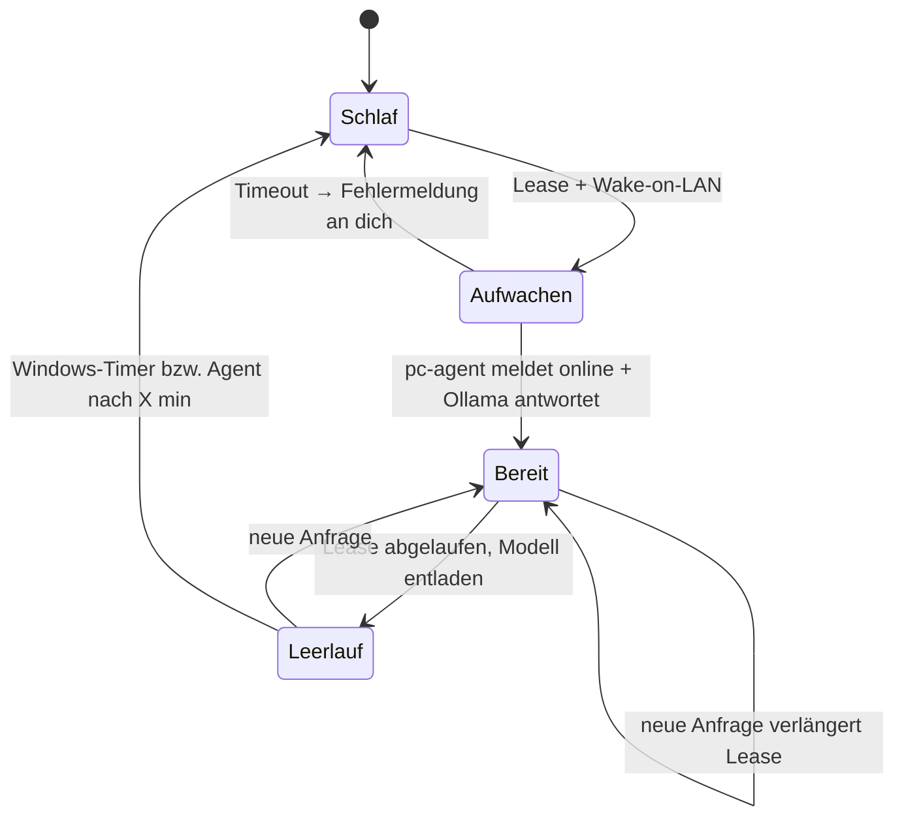

# 05 – Routing: lokal oder Gehirn?

Ziel: Einfache Befehle laufen **immer** lokal auf dem Pi, ohne LLM. Nur was der Pi
nicht kann, weckt PC oder GPU-Server.

## Drei Eingangswege

| Eingang | Weg | Weckt PC? |
|---|---|---|
| Sprache, Wake-Word 1 (z. B. „Okay Nabu“) | Pipeline **Lokal**: Speech-to-Phrase → HA-Intents → Piper | **Nie.** Unbekannter Satz → „Das kann ich lokal nicht. Sag ‚Hey Jarvis‘ für das große Gehirn.“ |
| Sprache, Wake-Word 2 (z. B. „Hey Jarvis“) | Pipeline **Gehirn**: brain-stt-proxy (Whisper auf PC) → `brain_router` → Piper | Ja, sofort beim Wake-Word (parallel zum Sprechen) |
| Text (Dashboard-Chat, Handy-App) | `brain_router` | Nur wenn lokal kein Treffer |

Warum zwei Wake-Words? Speech-to-Phrase erkennt nur Sätze, die es vorher kennt
(dafür in < 1 s auf dem Pi). Freie Sätze braucht Whisper – und das braucht den
PC. Ein einziges Wake-Word würde also *jede* Anfrage zum PC schicken. Mit zwei
Wake-Words entscheidest du beim Sprechen, ob sich das Aufwecken lohnt.

## Komponenten (werden in M3/M4 gebaut)

### 1. `brain_router` – Home-Assistant-Integration (Python, läuft im HA-Prozess)

Ein Konversations-Agent, den du in HA als Assistent auswählst.

```
Eingabe-Text
   │
   ├─1─► HA-Standard-Agent (Intents, eigene Sätze)  ── Treffer ──► ausführen, fertig
   │
   ├─2─► Aufgabentyp bestimmen (Regeln, kein LLM):
   │        „druck|slice|stl|filament“  → print-planning
   │        „aufräum|schreibtisch|wo gehört“ → vision
   │        sonst                        → chat
   │
   ├─3─► Backend wählen (siehe Policy unten)
   │
   ├─4─► Lease anfordern, ggf. Wake-on-LAN, warten bis Ollama antwortet
   │        (Timeout PC 60 s, Server 120 s → sonst ehrliche Fehlermeldung)
   │
   └─5─► Ollama /api/chat (Streaming) → Antwort
```

Warum eine eigene Integration statt HAs eingebauter Ollama-Integration? Die
eingebaute erwartet einen dauerhaft erreichbaren Server; bei schlafendem PC
schlägt sie fehl und versucht es mit wachsenden Pausen erneut. `brain_router`
weiß dagegen, dass das Gehirn schläft, weckt es und wartet gezielt.

Die Kernlogik (Entscheiden, Wecken, Lease, Ollama-Client) liegt als reines
Python-Paket ohne HA-Abhängigkeit vor → per `pytest` testbar, auch ohne Pi.

### 2. `brain-stt-proxy` – Wyoming-Dienst auf dem Pi (Add-on)

Problem: Die Gehirn-Pipeline beginnt sofort mit dem Audio-Stream, der PC ist aber
noch nicht wach. Lösung: Ein kleiner Dienst auf dem Pi tut so, als wäre er der
Whisper-Server:

1. Audio beginnt → Lease + Wake-on-LAN auslösen, Audio im RAM puffern
2. Whisper auf dem PC erreichbar → gesamten Puffer weiterleiten
3. Text zurück an HA
4. PC nicht rechtzeitig wach → Sondertext, den `brain_router` als
   „Gehirn nicht erreichbar“ beantwortet

### 3. `pc-agent` – kleiner Dienst auf PC bzw. Server

| Aufgabe | Windows (PC) | Linux (Server) |
|---|---|---|
| Status melden | MQTT `brain/<name>/status` (retained), Last Will = `offline` | gleich |
| Wach halten | `SetThreadExecutionState(ES_SYSTEM_REQUIRED)` solange Lease aktiv oder Ollama ein Modell geladen hat | `systemd-inhibit` |
| Schlafen legen | macht Windows selbst (Energieoptionen) | Agent ruft `systemctl suspend` nach X min ohne Lease |
| Gaming erkennen | Liste von Spiel-Prozessen / Vollbild-App → `gaming: true` | – |

**Warum Windows das Schlafen selbst machen soll:** Windows berücksichtigt schon
Tastatur/Maus, Videowiedergabe, Steam-Downloads usw. Der Agent ergänzt nur, was
Windows nicht sieht: Anfragen aus dem Netz. Weniger eigener Code, weniger Fehler.

**Wichtig – „unbeaufsichtigtes Aufwachen“:** Nach Wake-on-LAN ohne Tastatureingabe
legt sich Windows nach ≈ 2 min wieder schlafen. Der Agent muss deshalb schnell
starten und die Lease sofort halten.

## MQTT-Themen

| Thema | Richtung | Inhalt |
|---|---|---|
| `brain/<name>/status` | Agent → HA | `{"state":"online","gaming":false,"models":["qwen3:30b"],"leases":1,"idle_s":120}` (retained); `offline` als Last Will |
| `brain/<name>/lease` | HA → Agent | `{"id":"chat-42","ttl":600,"reason":"chat"}` – verlängert bei jeder Anfrage |
| `brain/<name>/cmd` | HA → Agent | `sleep` (nur wenn kein Gaming, keine Eingabe in den letzten 5 min) |

## Backend-Policy

```yaml
# Ausschnitt der späteren Konfiguration (Werte aus secrets.yaml)
backends:
  - name: gpu-server        # erst ab M12
    capabilities: [llm, llm-large, vision, stt]
    priority: 1
    wake_timeout_s: 120
  - name: gaming-pc
    capabilities: [llm, vision, stt, slicing]
    priority: 2
    wake_timeout_s: 60
    yield_to_gaming: true   # beim Spielen nicht stören
```

Regeln, in dieser Reihenfolge:

1. Nur Backends, die die nötige Fähigkeit haben (z. B. `slicing` → nur PC).
2. Ein bereits waches Backend schlägt ein schlafendes (Wecken kostet Zeit + Strom).
3. Gaming-PC mit `gaming: true` → überspringen; ist er die einzige Option:
   nachfragen („Du spielst gerade – trotzdem?“) statt still die GPU zu belegen.
4. Sonst niedrigste `priority` → wecken.

## Lebenszyklus einer Lease



Einstellbar in HA (Helfer, M3): Lease-Dauer (Standard 10 min), Ollama
`OLLAMA_KEEP_ALIVE` (Standard 5 min), Windows-Standby (Standard 20 min).

## Ehrliche Latenzen

| Situation | Bis zur ersten Antwort |
|---|---|
| Lokaler Befehl | ≈ 1 s |
| Gehirn wach, Modell geladen | 2–5 s |
| Gehirn schläft | 10–25 s (Aufwachen 3–8 s + Modell laden 3–10 s + Antwort) |
| GPU-Server aus (Kaltstart statt Schlaf) | 60–90 s |

Gegen das Warten hilft: sofortige Ansage „Moment, ich wecke das Gehirn“ (M4) und
eine Dashboard-Anzeige des Gehirn-Zustands.
