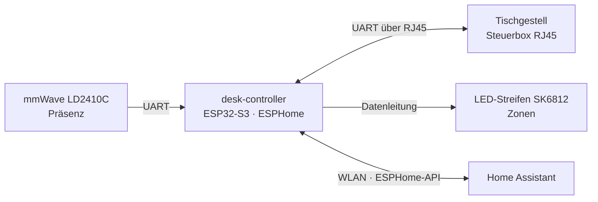

# 07 – Neuer Schreibtisch

Status: **Planung**. Maße, Budget und Standort fehlen noch ([Offene Fragen](00-offene-fragen.md)).

## Konzept: ein Steuergerät für den ganzen Tisch

Statt fünf Einzelgeräten steuert **ein ESP32-S3 mit ESPHome** („desk-controller“)
unter der Tischplatte alles, was Logik braucht:

Ein Gerät = ein Netzteil, ≈ 1 W Eigenverbrauch, eine Firmware. Die schaltbaren
Steckdosen sind Zigbee (Strom sollte nicht über Selbstbau geschaltet werden).

## Features

| Feature | Umsetzung | Warum so |
|---|---|---|
| **Höhenverstellung per Sprache/Dashboard** | Gestell mit Steuerbox, die das Protokoll des Projekts [LoctekMotion_IoT](https://github.com/iMicknl/LoctekMotion_IoT) spricht (viele FlexiSpot-Modelle). ESP liest Höhe, fährt Speicherplätze an. | Kein Eingriff in die Elektrik, Original-Handschalter bleibt nutzbar. **Vor dem Kauf** Modell der Steuerbox prüfen (z. B. HS13A-1, HS13B-1, HS01B-1 sind dokumentiert). |
| **Sitz/Steh-Erinnerung** | HA zählt „anwesend + Höhe sitzend“; nach 45 min: LED-Puls + Ansage; nach 30 min stehen: Hinweis. Pausiert bei Abwesenheit und in Szene „Gaming“. | Werte einstellbar als HA-Helfer |
| **Präsenz → Strom sparen** | LD2410C (mmWave, erkennt auch Stillsitzen) unter der Platte. 3 min abwesend: Monitor-/Lautsprecher-Steckdose aus, Tischlicht aus, Tablet-Bildschirm aus. Zurück: alles an. | Der PC schläft über seine eigene Logik ([05-routing.md](05-routing.md)) – wird **nie** per Steckdose abgeschaltet |
| **LED-Zonen** | SK6812-RGBW-Streifen (60 LED/m) in Alu-Profil mit Diffusor an der Vorder-/Hinterkante; in ESPHome in **Segmente** geteilt → jede Zone (Ablageplatz, Status, Benachrichtigung) ist eine eigene Lampe in HA | Zonen lassen sich später ohne Löten neu aufteilen |
| **Kabelkanal mit schaltbaren Steckdosen** | Metall-Kabelwanne unter der Platte, darin 3–4 Zigbee-Messsteckdosen oder eine Zigbee-Leiste mit einzeln schaltbaren Dosen | Messung + Schalten pro Gerät, Energie-Dashboard sieht alles |
| **Kabellose Ladefläche** | Unter-Tisch-Qi-Lader, der durch die Platte lädt (Plattenstärke ≤ Herstellerangabe, meist 15–30 mm) + 🖨 Halter + Markierung auf der Platte | Unsichtbar; hängt an schaltbarer Dose (nachts aus) |
| **Schiene für Kamera und Roboterarm** | Alu-Profil 2040 entlang der Hinterkante; Kamera-Arm ≈ 80 cm über der Platte; 🖨 Adapterplatte für den Arm in einer festen Ecke | Feste Positionen = Kalibrierung bleibt gültig, auch wenn der Tisch fährt (alles fährt mit) |
| **Touch-Display** | Android-Tablet 8–11" in 🖨 Halterung, Dashboard-Ansicht „Tisch-Panel“ | Browserfähig (gleiches Dashboard), Akku, ≈ 0,5 W bei Bildschirm aus. Ein Pi mit Touchscreen wäre ein weiteres Dauergerät mit 2–4 W |

## Teileliste mit Kosten

| Teil | Preis | Selbst druckbar |
|---|---|---|
| Elektrisches Gestell, 2 Motoren, kompatible RJ45-Steuerbox | 350–550 € | – |
| Tischplatte (Spanplatte 80–150 €, Multiplex Birke 25 mm 200–350 €) | 80–350 € | – |
| ESP32-S3-Board | 8–15 € | 🖨 Gehäuse |
| RJ45-Splitter/Breakout zur Steuerbox | 5–10 € | – |
| HLK-LD2410C | 4–8 € | 🖨 Halter |
| SK6812 RGBW, 2–3 m | 20–35 € | – |
| 5-V-Netzteil 10 A (für LEDs + ESP) | 15–25 € | 🖨 Abdeckung |
| Alu-Profil + Diffusor, 2–3 m | 15–25 € | 🖨 Endkappen, Clips |
| Kabelwanne | 25–40 € | 🖨 Kabelclips, Durchführungen |
| Zigbee-Steckdosen (3–4) oder Zigbee-Leiste | 45–70 € | – |
| Unter-Tisch-Qi-Lader | 30–60 € | 🖨 Halter, Inlay |
| Alu-Profil 2040 + Klemmen + Kamera-Arm | 40–80 € | 🖨 Adapter, Kamera-Klappe |
| USB-Webcam (Bild von oben) | 50–150 € | 🖨 Halter |
| Android-Tablet | 100–200 € | 🖨 Halterung |
| Kleinteile (Kabel, Stecker, Schrauben, Kabelbinder) | 20–30 € | – |
| **Summe** | **≈ 800–1.650 €** | |

## Sicherheit am Tisch

- Beim Fahren muss der Roboterarm in Parkposition sein (HA blockiert die Fahrt sonst).
- Kollisionsschutz des Gestells aktiv lassen.
- LED-Netzteil abgesichert und nicht unter Papier/Holz eingebaut, Kabel zugentlastet.

## Was du selbst umsetzen kannst

Gestell + Platte montieren, Kabelwanne und Profil anschrauben, Druckteile drucken,
LED-Streifen zuschneiden und einkleben. Ich liefere ESPHome-Konfiguration,
Verdrahtungsplan, HA-Automationen und die Druckteile (Maße nach Kauf).
