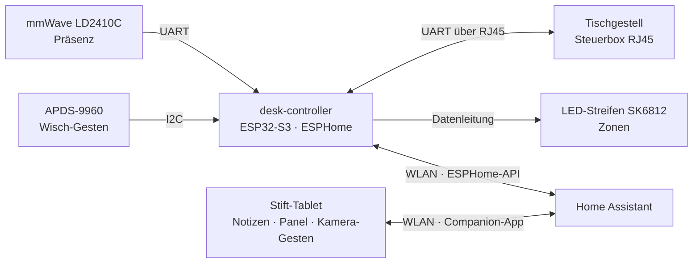

# 07 – Neuer Schreibtisch

Status: **Planung**. Maße, Budget und Tablet-Wahl fehlen noch ([Offene Fragen](00-offene-fragen.md)).
Gehört zu Phase 1 im [Arbeitszimmer](11-arbeitszimmer.md).

## Konzept: ein Steuergerät + ein Stift-Tablet

Ein **ESP32-S3 mit ESPHome** („desk-controller“) unter der Tischplatte steuert
alles mit Logik. Ein **Tablet mit Stift**, flach in die Platte eingelassen, ist
Notizblock, Bedienpanel und (später) Gesten-Kamera zugleich.

Alles davon läuft **ohne den PC**. Der PC wird nur für Bildverarbeitung
(Aufräumen, Papier-Notizen erkennen) geweckt.

## Features

| Feature | Umsetzung | Warum so |
|---|---|---|
| **Höhenverstellung per Sprache/Dashboard** | Gestell mit Steuerbox, die das Protokoll von [LoctekMotion_IoT](https://github.com/iMicknl/LoctekMotion_IoT) spricht (viele FlexiSpot-Modelle). ESP liest die Höhe und fährt Speicherplätze an. | Kein Eingriff in die Elektrik, Handschalter bleibt. **Vor dem Kauf** Steuerbox-Modell prüfen (dokumentiert u. a. HS13A-1, HS13B-1, HS01B-1). |
| **Sitz/Steh-Erinnerung** | HA zählt „anwesend + sitzende Höhe“; nach 45 min LED-Puls + Ansage, nach 30 min Stehen Hinweis. Pausiert bei Abwesenheit und in „Gaming“. | Zeiten als HA-Helfer einstellbar |
| **Präsenz → Strom sparen** | LD2410C (erkennt auch Stillsitzen). 3 min weg: Monitor-/Lautsprecher-Steckdose, Tischlicht und Tablet-Bildschirm aus. Zurück: an. | PC schläft über seine eigene Logik ([05-routing.md](05-routing.md)) – nie per Steckdose |
| **Mit Stift auf den Tisch schreiben** | Stift-Tablet flach im Tisch, siehe unten | Ersetzt das separate Touch-Display |
| **Gesten („Iron Man“)** | Stufenweise, siehe unten | |
| **LED-Zonen** | SK6812-RGBW (60 LED/m) im Alu-Profil mit Diffusor; in ESPHome in Segmente geteilt → jede Zone (Ablageplatz, Status, Benachrichtigung) ist eine eigene Lampe in HA | Zonen später ohne Löten neu aufteilbar |
| **Kabelkanal mit schaltbaren Steckdosen** | Kabelwanne unter der Platte, darin 3–4 Zigbee-Messsteckdosen | Messen + Schalten pro Gerät |
| **Kabellose Ladefläche** | Unter-Tisch-Qi-Lader, lädt durch die Platte (Plattenstärke ≤ Herstellerangabe) + 🖨 Halter | Unsichtbar; nachts aus |
| **Schiene für Kamera und Roboterarm** | Alu-Profil 2040 an der Hinterkante; Kamera ≈ 80 cm über der Platte; 🖨 Adapterplatte für den Arm | Alles fährt mit dem Tisch mit → Kalibrierung bleibt gültig |

## Mit Stift auf den Tisch schreiben

| Stufe | Was | Kosten | PC nötig? |
|---|---|---|---|
| **1 – Start (Vorschlag)** | **Tablet mit Stift**, zuerst in einem 🖨 flachen Rahmen auf dem Tisch, erst wenn die Position passt bündig eingelassen. Kurze To-dos schreibst du direkt per Stift in eine HA-To-do-Liste; längere Notizen in der Notiz-App, bei Bedarf an HA teilen. | ≈ 420–520 € | nein |
| 2 – Bonus | Dasselbe Tablet wird per App (SuperDisplay, ≈ 10 €) zum **druckempfindlichen Zeichentablett für den PC** – für Skizzen oder CAD, wenn der PC eh läuft. | ≈ 10 € | ja |
| 3 – Spaßprojekt | **Papier → Kamera → lokale KI → To-do-Liste.** Braucht eine nähere Kamera; die Aufräum-Kamera in 80 cm Höhe ist für Handschrift zu grob. | 0–120 € | ja |
| 4 – Profi-Spaßprojekt | **Skizze → KI schreibt OpenSCAD → 3D-Druck.** Funktioniert nur für einfache Teile mit Maßangaben, immer vor dem Druck prüfen. | 0 € | ja |
| ✗ | Projektor, der aufs Holz „schreibt“, oder E-Ink-Tablets | teuer bzw. Cloud | – |

**Tablet-Wahl** (hängt davon ab, ob du iPhone oder Android nutzt):

| | Samsung Galaxy Tab S10 FE | iPad (A16) + Apple Pencil (USB-C) |
|---|---|---|
| Preis | ≈ 400 € + Ladegerät 20–30 € (Stift liegt bei) | ≈ 380 € + ≈ 90 € Stift |
| Stift | passiv: nie laden, nie koppeln, druckempfindlich | muss per Kabel geladen werden, **nicht** druckempfindlich |
| Besonderheiten | wasserdicht (IP68) – gut bei verschüttetem Getränk | Handschrift→Text läuft auf Deutsch direkt auf dem Gerät |
| Home Assistant | Companion-App mit Akku-Temperatur-Sensor, gut als Wandpanel | Companion-App mit Kiosk-Modus |

Beide haben eine **80-%-Ladegrenze** – wichtig, weil das Tablet dauerhaft am
Strom hängt. Zusätzlich überwacht HA die Akkutemperatur.

Worauf es beim Einlassen ankommt:

- **Hitze:** Eine geschlossene Tasche + Dauerladen = warmer Akku. Tasche belüften (Schlitze/Luftspalt).
- **Erst ausprobieren:** Eine Fräsung in eine neue Platte ist endgültig. Erst den gedruckten Rahmen, dann fräsen – und mit deinen Eltern abstimmen, falls es ein Familienkauf ist.
- **Kabel** müssen beim Hoch-/Runterfahren mitfahren (Ladegerät unter der Platte).
- Für den Roboterarm ist das Tablet eine **Sperrzone**, und eine matte Schutzfolie verhindert Spiegelungen in der Kamera.

## Gesten („Iron Man“)

| Stufe | Was | Kosten | PC nötig? | Aufwand |
|---|---|---|---|---|
| **1 – Wisch-Sensor** | **APDS-9960** in der Tischkante am desk-controller: Hand links/rechts/hoch/runter wischen → Szene wechseln, dimmen, Musik weiter. [ESPHome unterstützt ihn direkt](https://github.com/esphome/esphome/tree/dev/esphome/components/apds9960). | ≈ 5–15 € | nein | 1–2 h |
| **2 – Kamera-Gesten (der echte Iron-Man-Effekt)** | Die **Frontkamera des eingelassenen Tablets** schaut nach oben. Googles MediaPipe erkennt im Browser deine Hand darüber: offene Hand, Faust, Daumen hoch/runter, Zeigen, Victory. Jede Geste ruft ein HA-Skript auf. Alles läuft auf dem Tablet, nichts verlässt das Gerät. | 0 € | nein | 1 Wochenende |
| 3 – Ganzer Tisch | Die Aufräum-Kamera von oben verfolgt deine Hände über den ganzen Tisch: auf eine Zone zeigen, Finger zusammenkneifen zum Dimmen, „hier aufräumen“ für den Roboter. | 0 € | ja | mehrere Wochenenden |
| ✗ | Leap Motion (vom Markt verschwunden), Projektor-Tisch (≈ 200 W, tagsüber zu blass) | – | – | – |

Spielregeln, damit es nicht nervt:

- Geste **≈ 0,6 s halten**, danach kurze Pause → keine Fehlauslöser beim normalen Arbeiten.
- Erkennung läuft nur, wenn der Präsenzsensor dich am Tisch sieht.
- Gesten fahren den Tisch **nur auf gespeicherte Höhen**, nie frei – Sicherheit.
- Kamera-Gesten brauchen **HTTPS** für Home Assistant im Heimnetz (Browser geben die Kamera sonst nicht frei). Das richten wir vorher ein ([Sicherheit](04-sicherheit.md)).
- Sichtbares Zeichen, wann die Kamera aktiv ist (z. B. LED-Farbe), Abdeckung für die Linse.

Zusammen mit „Hey Jarvis“ per Sprache fühlt sich schon Stufe 2 ziemlich nach Iron Man an.

## Teileliste mit Kosten

| Teil | Preis | Selbst druckbar |
|---|---|---|
| Elektrisches Gestell, 2 Motoren, kompatible RJ45-Steuerbox | 350–550 € | – |
| Tischplatte (Spanplatte 80–150 €, Multiplex Birke 25 mm 200–350 €) | 80–350 € | – |
| ESP32-S3-Board | 8–15 € | 🖨 Gehäuse |
| RJ45-Splitter/Breakout zur Steuerbox | 5–10 € | – |
| HLK-LD2410C | 4–8 € | 🖨 Halter |
| APDS-9960 (Original-Chip, keine Billigkopie) | 5–15 € | 🖨 Blende |
| SK6812 RGBW, 2–3 m | 20–35 € | – |
| 5-V-Netzteil 10 A (für LEDs + ESP) | 15–25 € | 🖨 Abdeckung |
| Alu-Profil + Diffusor, 2–3 m | 15–25 € | 🖨 Endkappen, Clips |
| Kabelwanne | 25–40 € | 🖨 Kabelclips, Durchführungen |
| Zigbee-Steckdosen (3–4) | 45–70 € | – |
| Unter-Tisch-Qi-Lader | 30–60 € | 🖨 Halter, Inlay |
| Alu-Profil 2040 + Klemmen + Kamera-Arm | 40–80 € | 🖨 Adapter, Kamera-Klappe |
| USB-Webcam (Bild von oben) | 50–150 € | 🖨 Halter |
| Stift-Tablet + Ladegerät | 420–520 € | 🖨 Rahmen |
| Kleinteile (Kabel, Stecker, Schrauben) | 20–30 € | – |
| **Summe** | **≈ 1.130–2.000 €** | |

Größte Posten: Gestell, Platte, Tablet. Sparen ohne Funktionsverlust: Spanplatte
statt Multiplex, Tablet gebraucht oder als Letztes kaufen (bis dahin dient das
Handy als Panel).

## Sicherheit am Tisch

- Beim Fahren muss der Roboterarm in Parkposition sein (HA blockiert die Fahrt sonst).
- Kollisionsschutz des Gestells aktiv lassen.
- LED-Netzteil abgesichert und nicht unter Papier/Holz eingebaut, Kabel zugentlastet.

## Was du selbst umsetzen kannst

Gestell + Platte montieren, Kabelwanne und Profile anschrauben, Druckteile
drucken, LED-Streifen zuschneiden, Sensoren anlöten (oder steckbare Varianten).
Ich liefere ESPHome-Konfiguration, Verdrahtungsplan, HA-Automationen, die
Gesten-Karte fürs Dashboard und die Druckteile (Maße nach Kauf).
