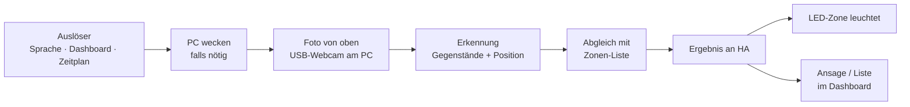

# 09 – Aufräum-System und Roboterarm

## Stufe 1: KI sagt, was wohin gehört (M10)

| Baustein | Umsetzung | Warum |
|---|---|---|
| Kamera | USB-Webcam am PC, ≈ 80 cm über der Platte an der Schiene | Kein weiteres Dauergerät; das Bild wird ohnehin nur gebraucht, wenn der PC rechnet |
| Kalibrierung | 4 ArUco-Marker (🖨 oder ausgedruckt) an den Tischecken → Umrechnung Bildpunkt ↔ Tisch-Millimeter | Gilt auch nach dem Hochfahren, weil Kamera mitfährt |
| Erkennung | Vision-Sprachmodell über Ollama (liefert Gegenstände + Boxen als JSON), für häufige Gegenstände ergänzend ein kleiner Detektor (ONNX, läuft unter Windows auch auf AMD) | VLM versteht „Unordnung“ und Sonderfälle, Detektor ist schnell und genau |
| Zonen | Konfigurationsdatei: Gegenstand → Zone („Schere → Schale links“), Zone → LED-Segment | Du pflegst die Liste selbst |
| Ausgabe | LED-Segment der Zielzone blinkt; Liste „Kabel → Kabelfach, Tasse → Küche“ | |

## Stufe 2: Roboterarm SO-101 (M11)

[SO-101](https://github.com/TheRobotStudio/SO-ARM100) ist ein offener 6-Achs-Arm
(LeRobot-Projekt von Hugging Face) aus Druckteilen und 6 Feetech-STS3215-Servos.
Alle Teile passen auf das X2D-Bett (256 × 256 mm).

### Zwei Wege zur Steuerung

| | A) Klassisch: Erkennen → Rechnen → Greifen (Vorschlag) | B) Lernen per Vormachen (LeRobot) |
|---|---|---|
| Prinzip | Kamera liefert Position, inverse Kinematik berechnet Gelenkwinkel, Arm greift und legt in Zone | Du führst den Arm mit einem zweiten „Leader“-Arm, ein Modell lernt die Bewegung |
| Hardware | nur Follower-Arm | Follower + Leader (+ ≈ 100–120 €) |
| Rechenbedarf | gering | Training auf GPU; LeRobot ist auf NVIDIA/Linux am einfachsten → passt zum GPU-Server (M12) |
| Gut für | definierte Kleinteile, feste Zonen | unregelmäßige Gegenstände, komplexe Griffe |

Start mit A; B ist als Ausbau möglich, ohne etwas wegzuwerfen.

### Grenzen, ehrlich

- Nur leichte Kleinteile (Stifte, Schrauben-Schälchen, USB-Sticks, Kabel­binder), keine Tassen mit Inhalt.
- Reichweite des SO-101 begrenzt (beim Aufbau messen) → Arm in einer Ecke, Zonen in Reichweite.
- Sicherheit: Arm fährt nur, wenn du ihn startest; Parkposition vor Tischfahrt; Not-Aus = Steckdose des Arm-Netzteils (per Sprache und Taster).

### Druckteile

STLs aus dem SO-ARM100-Repository (SO-101-Ordner), PLA oder PETG, ≈ 0,5–0,8 kg.
Dazu: 🖨 Basisplatte für die Schiene, Zonen-Schalen, Kamera-Halter.
