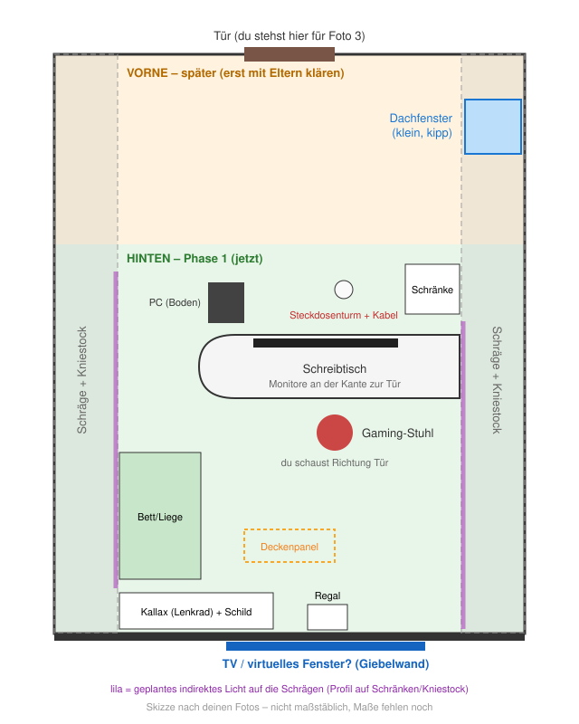

# 11 – Arbeitszimmer (Dachgeschoss)

Status: **Phase 1 (hintere Raumhälfte) in Planung.** Die vordere Hälfte (Tür,
Dachfenster, Lüftung) wartet, bis du mit deinen Eltern gesprochen hast.

Die Skizze ist aus deinen Fotos rekonstruiert und **nicht maßstäblich**. Sobald
du Maße schickst, wird daraus auch der klickbare Grundriss fürs Dashboard.

## Bestandsaufnahme (aus den Fotos)

| Beobachtung | Warum relevant | Lösung (Schritt) |
|---|---|---|
| Kabelsalat und Steckdosenturm auf dem Boden, ein Karton daneben | Stolperfalle, Kabel werden überrollt, Karton = Brandlast neben Steckern | Schritt 1 |
| Gaming-PC steht direkt auf dem Boden | zieht Staub, wird getreten | Schritt 1 |
| Lose Platinen und Teile auf Schränken und Tisch | Kurzschluss/Staub, Unordnung | Schritt 1 (Bastelkisten) – später das Aufräum-System |
| Lila LED-Leisten ohne Abdeckung, sichtbare Punkte, grelle Flecken | sieht unruhig aus, blendet, beleuchtet ausgerechnet den Kabelsalat | Schritt 2 |
| Einziges Deckenlicht hängt **hinter** dir | Spiegelungen in den Monitoren, Gesicht für die Kamera dunkel, kein Licht auf der Tischfläche | Schritt 2 + Arbeitslicht am Tisch |
| Größte freie senkrechte Fläche: Giebelwand hinten | einziger guter Platz für einen Fernseher | Schritt 4 |
| Nur ein kleines Dachfenster | wenig Tageslicht, schlechte Lüftung | Schritt 2 (Tageslicht-Simulation), Phase 2 (Lüftung) |

## Phase 1 – hintere Hälfte

Jeder Schritt funktioniert für sich. Reihenfolge = Vorschlag.

### Schritt 1: Aufräumen und Kabel (fast gratis, sofort)

- Steckdosenturm vom Boden weg: eine **Kabelwanne unter die Tischplatte** schrauben (≈ 20–30 €). Die wandert später an den neuen Tisch mit.
- PC vom Boden: kleiner Sockel oder Rollbrett (🖨 druckbar), mindestens 10 cm hoch.
- Lose Platinen in beschriftete Kisten (ESD-Beutel für Platinen).
- Karton weg von den Steckern.

**Warum zuerst:** Alles Weitere (Licht, neuer Tisch, Kamera fürs Aufräumen)
funktioniert besser auf einem Tisch ohne Kabelchaos – und es kostet fast nichts.

### Schritt 2: Licht an den Schrägen (gehört zu M2)

**Idee:** Statt LED-Punkte direkt zu sehen, strahlt ein Streifen von oben auf
den Schränken bzw. dem Kniestock **die Schräge hinauf**. Die ganze Schräge wird
zur großen, weichen Lichtfläche. In einem Raum mit wenig Fenster wirkt das wie
ein heller Himmel.

| Teil | Wahl | Preis |
|---|---|---|
| Streifen | 24-V-**COB**-Streifen (keine sichtbaren Punkte), CRI ≥ 90, je Seite ≤ 5 m. RGB+CCT (farbig + weiß) **oder** nur CCT (warm–kalt-weiß, bei gleichem Geld deutlich heller) | 2 × 35–77 € |
| Steuerung | 2 × Gledopto **GL-C-008P** (Zigbee, „Pro“-Version – nur die leitet im Zigbee-Netz weiter), [von Zigbee2MQTT voll unterstützt](https://github.com/Koenkk/zigbee2mqtt.io/blob/master/docs/devices/GL-C-008P.md) | 2 × 27–33 € |
| Netzteil | **ein** Mean Well GST120A24 (Steckernetzteil, ≤ 0,15 W Leerlauf) für alles | 35–70 € |
| Profil | 45°-Alu-Eckprofil mit Milchglas-Abdeckung, auf Schrank/Kniestock | 40–100 € |
| Kleinteile | Kabel, 6-pol. Steckverbinder, Wago-Klemmen | 20–35 € |
| **Summe** | | **≈ 220–430 €** |

**Sparvariante zum Start:** nur eine Schräge (≈ 120–220 €), die zweite später.

Regeln, die Ärger sparen:

- **Nie in die Schräge schrauben** – dahinter liegt die Dampfbremse (Feuchtigkeit, Schimmel). Profil an Schrank oder Kniestock befestigen.
- Erst **provisorisch testen** (mit Klebeband), von Stuhl und Bett aus prüfen, dass keine LED direkt sichtbar ist.
- **Ein** Netzteil für alles, dauerhaft an der Steckdose. Nicht per Zwischenstecker auf der 230-V-Seite schalten: Der Stecker braucht selbst mehr Strom, als er spart, und die Controller fallen aus dem Zigbee-Netz.
- In Zigbee2MQTT `power_on_behavior: previous` setzen, sonst geht nach einem Stromausfall nachts das Licht an.
- Netzteil und Controller nicht an den Heizkörper.

**Automatik:** Die Integration [Adaptive Lighting](https://github.com/basnijholt/adaptive-lighting)
(HACS) führt Helligkeit und Farbtemperatur mit dem Sonnenstand: tagsüber hell und
neutralweiß wie Tageslicht, abends warm und gedimmt. In einem Zimmer mit wenig
Fenster lohnt sich das besonders. RGB-Farben nur für Szenen wie „Gaming“.

**Alte lila Leiste:** weiterverwenden nur, wenn sie 4 Adern hat und 24 V
(dann z. B. als unsichtbares Leuchten unterm Bett). 5 V/USB oder 3 Adern
(adressierbar) → in Rente schicken.

**Arbeitslicht:** Indirektes Licht reicht nicht für die Tischfläche. Dazu kommt
eine Monitor-Lichtleiste oder die LED-Zonen des neuen Tisches.

**Strom:** Standby für alles zusammen ≈ 1 W. Im Betrieb bei 30–50 % weiß ≈ 15–40 W.

### Schritt 3: Neuer Schreibtisch (M9)

Mit Stift-Tablet zum Schreiben, Gesten-Steuerung, LED-Zonen und später dem
Aufräum-System. Details: [07-schreibtisch.md](07-schreibtisch.md).

### Schritt 4: Virtuelles Fenster (Fernseher an der Giebelwand)

| Entscheidung | Wahl | Warum |
|---|---|---|
| Gerät | **43" LED-LCD mit LG webOS** (≈ 280–380 €), 50" nur wenn Platz (≈ 111 × 64 cm) | HA steuert LG [lokal](https://www.home-assistant.io/integrations/webostv/), Einschalten per Wake-on-LAN, eingebauter Player für lokale Videos |
| Nicht OLED | | Stundenlang ein ruhiges Landschaftsbild = Einbrenn-Risiko; helle Himmelsbilder treiben den Verbrauch hoch |
| Nicht „Casten“ (Chromecast/Google TV) | | Casten braucht Googles Server – der Fernseher soll aber in der FRITZ!Box **kein Internet** bekommen |
| Inhalt | Einmal heruntergeladene, lizenzfreie 4K-Fensterclips (Tag, Regen, Wolken, Dämmerung, Nacht, Schnee). HA wählt den Clip nach Sonnenstand und Wetter | Keine Kamera nötig, keine Rechtsfragen, kein Dauerstrom |
| Live-Bild draußen | optional später: lokale Kamera (z. B. Reolink, ohne Cloud) | **Nur eigenes Grundstück oder Himmel filmen** – bei einer Doppelhaushälfte heikel (Nachbar, DSGVO, BGH-Urteil genau zu diesem Haustyp). Vorher mit Nachbarn reden |
| An/Aus | nur wenn jemand im Raum ist und nicht Schlafenszeit; nach 10–15 min ohne Präsenz aus | Präsenz ist der größte Spar-Hebel |

**Strom:** ≈ 42–55 W an (43"), ≈ 2 W Netzwerk-Standby (nötig für das Einschalten
per Netzwerk). Bei 3 h/Tag inkl. Standby ≈ 65–80 kWh/Jahr ≈ 25–30 €.

**Montage:** an der hinteren Giebelwand. Nicht über dem Heizkörper, nicht in die
Schräge schrauben. Falls die Wand die **Trennwand zum Nachbarn** ist: Halterung
entkoppeln (Körperschall). Für Wake-on-LAN besser per LAN-Kabel anschließen
(beim PC liegt ja schon eins – ggf. kleiner Switch, ≈ 15 €, ≈ 1 W).

**Offene Frage:** Du sitzt am Schreibtisch mit Blick zur Tür – die Giebelwand ist
hinter dir. Willst du das „Fenster“ vom Schreibtisch aus sehen (dann Tisch beim
Neubau drehen?) oder vom Bett/Liege aus?

### Schon jetzt sinnvoll: CO₂ messen

Ein CO₂-Sensor (fertig mit Zigbee ≈ 30–80 €, oder Selbstbau ESP32 + SCD41 ≈ 25–40 €
mit 🖨 Gehäuse) braucht keine Installation. Nach zwei Wochen hast du eine Kurve,
wie schlecht die Luft wirklich wird – **das beste Argument fürs Gespräch mit deinen
Eltern** über Phase 2. Ziel: unter 1.000 ppm.

## Phase 2 – vordere Hälfte (später, nach Absprache)

Ergebnisse der Recherche, damit nichts verloren geht:

- **Physik:** Ein gekipptes Mini-Dachfenster schafft nur ≈ 20–50 m³/h Luft. Der PC erzeugt unter Last 400–500 W Wärme. Wichtiger als ein Motor ist eine **zweite Öffnung** (Tür + Treppenhaus/unteres Fenster), damit Luft durchziehen kann.
- **Sofort ohne Umbau:** Fensterkontakt + Innen-/Außentemperatur → HA meldet „Jetzt lüften, draußen kühler und trocken“ bzw. „Fenster zu, Regen“.
- **Fenstermotor:** hängt vom Typenschild ab. Bei passenden VELUX-Fenstern gibt es Solar-Nachrüstsätze mit eingebautem Regensensor; für sehr kleine Fenstergrößen passen sie teilweise nicht. Regenschutz muss **im Motor/in der Hardware** sitzen, nicht nur in HA.
- **Lüftungsgerät mit Wärmerückgewinnung** (Paar durch die **Außen**-Giebelwand, z. B. LUNOS e² 60): ≈ 1.600–2.600 € eingebaut, 0,4–3,3 W pro Gerät, über 0–10 V aus ESPHome lokal steuerbar. **Nie durch die Wand zum Nachbarn** (Brandwand, Öffnungen verboten) und nie in den Dachboden/die Abseite (Schimmel).
- **Sommerhitze** löst Lüftung nicht: Für 400–500 W PC-Wärme bräuchte man ≈ 300 m³/h. Hilft: PC schläft, wenn ungenutzt (ist eingeplant), Außenbeschattung am Dachfenster, ggf. Kühlung.

Fragen für das Gespräch mit den Eltern: Ist eine Kernbohrung in der
Außen-Giebelwand denkbar? Welche Giebelwand grenzt an die Nachbarhälfte?
